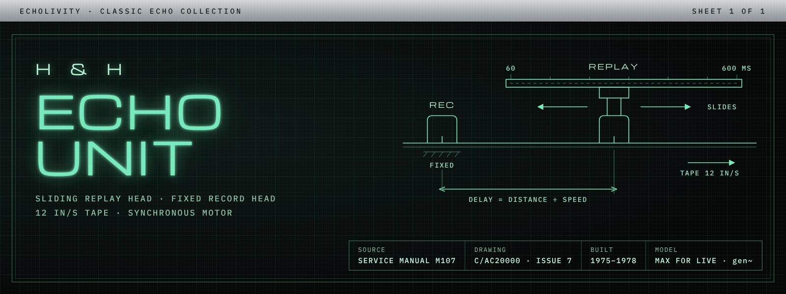
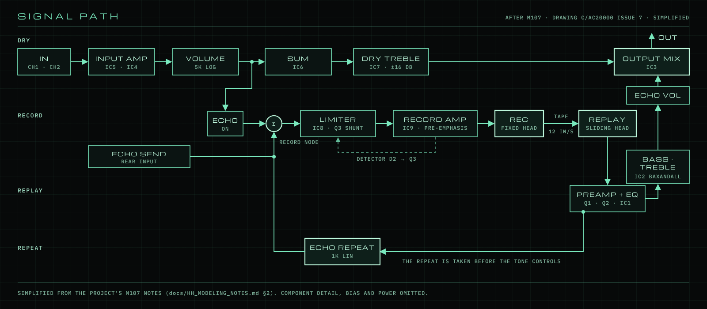
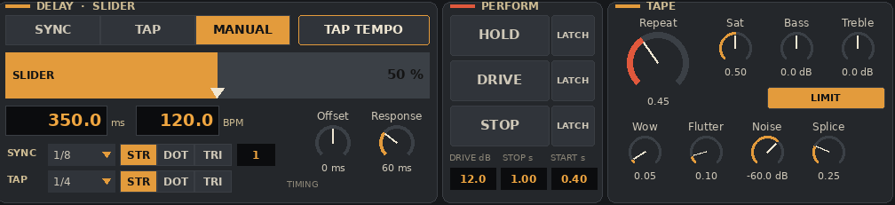
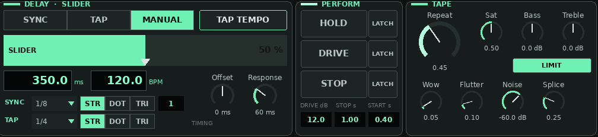

<div align="center">




</div>

```
ECHOLIVITY H&H ECHO UNIT · MAX FOR LIVE AUDIO EFFECT
Modelled on the HH Electronic Echo Unit (tape units 1975–1978)
from MAJ Electronic Service Manual M107 and circuit diagram C/AC20000, issue 7 (26-5-77).
```

> [!IMPORTANT]
> **Status: development line v0.2.3-dev, not yet run in Max 9 or Ableton Live 12.** The last release is **v0.2.1** (tag `v0.2.1`). Every check that can run without Max passes on the device's own code. Compiling in Max, loading in Live and listening by ear are still outstanding; see [§6](#6--test-procedure). Panel images are approximate renders, not screenshots.

---

## 1 · DESCRIPTION

The HH Echo Unit carries **one replay head on a sliding bar** above a fixed record head. Moving the head along the bar changes the distance to the record head, and with it the delay, so the slider is played as much as set. That's the reverse of the [Echoplex](https://github.com/Echolivity/echolivity-ep3), where the record head moves.

This device models the unit stage by stage from the M107 schematic: input amplifiers, the record limiter, the record amplifier with its pre-emphasis, 12 in/s tape, the replay preamp, the Baxandall tone stage, and the output mixer. On top of that it adds what a Live set needs: tempo sync, tap, HOLD, DRIVE and STOP, loop filters, and output protection.

## 2 · SPECIFICATION

**Tags:** **M107** = stated in the service manual · **CCT** = from the schematic · **DEV** = Echolivity design choice, not part of the original.

| Item | Value | Ref. |
|---|---|:--:|
| Transport | Single replay head on a sliding bar; record head fixed | M107 |
| Tape speed | 30.5 cm/s (12 in/s), synchronous motor, mains-locked | M107 |
| Tape loops | Short 650 mm (2.13 s) · long 3.0 m (9.84 s) → **SHORT / LONG** | M107 |
| Inputs | 2 channels into one mix; gain up to +6 dB at volume "10" → **Volume +6 dB = 10** | M107 |
| Dry treble | ±16 dB at 10 kHz | M107 |
| Echo bass / treble | ±10 dB at 100 Hz / ±14 dB at 10 kHz | M107 |
| Echo response | −3 dB at 70 Hz and 11 kHz | M107 |
| Record limiter | Threshold 80 mV in; 3 dB out per 30 dB in → **LIMIT** | M107 |
| Repeat | Taken from the replay preamp, before the tone controls | CCT |
| Slider delay range | Not given in M107 (bar travel unknown) → default **60–600 ms**, settable 2 ms – 4 s | DEV |
| Slider mechanism | **HEAD** (as M107) or **SPEED**: fixed head spacing, variable tape speed | M107 / DEV |
| Stereo | **MONO** as the unit, or **DUAL**; optional **DRY MONO** sum | M107 / DEV |
| Engine | One gen~ codebox (`dsp/hh_core.genexpr`) mirrored by a Python reference | — |

All 54 parameters: [`docs/PARAMETERS.md`](docs/PARAMETERS.md). Every modelling value and its tag: [`docs/HH_MODELING_NOTES.md`](docs/HH_MODELING_NOTES.md).

## 3 · SIGNAL PATH



<sub>Simplified from drawing C/AC20000. Component detail, bias and power are omitted.</sub>

## 4 · CONTROLS


<sub>Approximate render. 1,216 px wide in Live. Shown in the EL theme; EMBER (warm amber) is the default.</sub>

| Group | Controls |
|---|---|
| **4.1 Delay · slider** | SYNC / TAP / MANUAL · SLIDER (replay head) · sync / tap division, type (straight, dotted, triplet), multiplier · offset · slider response |
| **4.2 Perform** | HOLD · DRIVE · STOP: momentary pads (mouse or CC footswitch) with LATCH · drive amount · stop / start time |
| **4.3 Tape** | Echo Repeat · saturation · Echo Bass · Echo Treble · LIMIT · wow · flutter · noise · splice |
| **4.4 Filters** | Repeat HP / LP / Resonance (inside the loop) · Echo HP / LP · Dry Treble |
| **4.5 Output** | Dry · Echo · Output · meters · PROTECT with ceiling, GR and OVER |
| **4.6 Engine** | HEAD / SPEED · MONO / DUAL · SHORT / LONG · DRV FB · slider taper WIDE / HW · DRY MONO · head speed · transition · hold feedback · head spacing · slider range |

Every control can be automated, MIDI-mapped and saved with the set. Theme switch, top right:

| EMBER (default) | EL |
|:--:|:--:|
|  |  |

## 5 · INSTALLATION

1. Drag `devices/Echolivity_HH_v0.2.3-dev.amxd` onto an audio track in Ableton Live 12. For the last release instead, check out tag `v0.2.1` and use `devices/Echolivity_HH.amxd`.
2. **If Live refuses the file:**
   1. Add an empty **Max Audio Effect**, click **Edit**, and delete its `plugin~` / `plugout~`.
   2. Open `devices/Echolivity_HH_v0.2.3-dev.maxpat` in Max, select all and copy.
   3. Paste into the empty device and save it as an `.amxd`.

## 6 · TEST PROCEDURE

| Area | Built | Offline | Max 9 | Live 12 | Ears |
|---|:--:|:--:|:--:|:--:|:--:|
| Tape engine: sliding head, HEAD / SPEED, loops, splice | ✔ | ✔ | — | — | — |
| Feedback, record limiter, output protection | ✔ | ✔ | — | — | — |
| Hardware slider (taper, position, range) | ✔ | ✔ | — | — | — |
| Modulation-safe parameter smoothing | ✔ | ✔ | — | — | — |
| DRY MONO · themes | ✔ | ✔ | — | — | — |

✔ passed · — not yet run.

**Offline results (v0.2.3-dev):**

| Suite | Result |
|---|:--:|
| Reference suite | 38/38 |
| GenExpr source | 14/14 |
| Modulation | 4/4 |
| Hardware slider | 6/6 |
| Dry mono | 4/4 |
| UI theme | 4/4 |
| Master-stage prototypes | 33/33 |

The v0.2.3 rename of gen~-reserved names is bit-identical to v0.2.2.

**Procedure G01 / G03 (Max 9 only, about 20 minutes):**
1. Set Max audio to 48 kHz and open [`tests/golden/HH_golden_harness_v0.2.3-dev.maxpat`](tests/golden/).
2. Read the Max Console (G01).
3. Press RUN GOLD1, GOLD2 and GOLD3.
4. For each *n*: `python3 tests/golden/compare.py tests/golden/expect_GOLDn.wav tests/golden/out_GOLDn_max.wav`.

If the console names `s`, `f` or `r`, use [`tests/golden/fallback/`](tests/golden/fallback/). Full plan: [`docs/TEST_PLAN_Max_Live.md`](docs/TEST_PLAN_Max_Live.md).

## 7 · KNOWN FAULTS

| # | Fault | Workaround |
|:--:|---|---|
| 1 | Output protection is sample-peak only: up to +3.6 dBTP between samples on squares and clicks | Leave headroom; no true-peak claim |
| 2 | A MIDI note mapped to a momentary pad latches (Live sends no note-off to toggles) | Use a CC footswitch, 127 / 0 |
| 3 | Fast slider throws with feedback make an HF "siren" | By design: re-pitched content compounding over repeats; no excess aliasing measured |
| 4 | Saturation curve, wow / flutter rates, splice, stop / start times are approximations | Marked in the modelling notes |

Full list: [`KNOWN_LIMITATIONS.md`](KNOWN_LIMITATIONS.md) · status: [`RELEASE_STATUS.md`](RELEASE_STATUS.md) · history: [`CHANGELOG.md`](CHANGELOG.md).

## 8 · NOTES

The panel design is Echolivity's own. The EL theme takes its cue from the electroluminescent-lit panels of HH's 1970s units, but no HH logo, legends or panel graphics are copied. *HH is a trademark of its respective owner; this project is not affiliated with it.*

<details>
<summary><b>APPENDIX</b>: files and build</summary>

| Path | Contents |
|---|---|
| `devices/` | Device (`.amxd` and editable `.maxpat`) |
| `dsp/hh_core.genexpr` | DSP: a single gen~ codebox, the source of truth |
| `reference/` | Python / Numba mirror of the DSP; master-stage prototypes |
| `build/` | Device, parameter-table, harness, preview and report generators |
| `docs/` | Architecture, signal flow, parameters, modelling notes, test plan, reports, images (HTML sources in `docs/images/src/`) |
| `tests/` | Reference suite, GenExpr-source tests, Max 9 golden harness, CPU proxy, investigations, name lint |

```sh
pip install numpy scipy numba matplotlib      # gcc for the C tests and CPU proxy
python3 build/build_device.py && python3 build/make_param_table.py
python3 tests/run_tests.py && python3 tests/genexpr_sim/run_gx_tests.py
python3 tests/golden/make_golden.py           # references for the Max harness
```
When changing DSP, edit `dsp/hh_core.genexpr` and `reference/tape_engine.py` together; `run_gx_tests.py` fails if they diverge.

</details>

<div align="center">
<sub>ECHOLIVITY · CLASSIC ECHO COLLECTION · <a href="https://github.com/Echolivity/echolivity-ep3">EP-3 Tape Echo</a> · <a href="https://github.com/Echolivity/echolivity-dub-siren">Dub Siren</a> · <a href="https://github.com/Echolivity/fisher-spring">Fisher Spring</a></sub>
</div>
