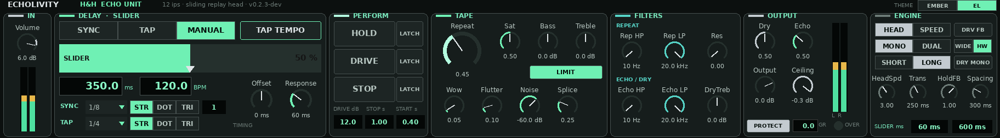

<div align="center">

# 🟥🟨🟩 ECHOLIVITY

# H&H ECHO UNIT

### A sliding-replay-head tape echo for Ableton Live 12

**SLIDE THE HEAD. RIDE THE REPEAT. KEEP THE TAPE TURNING.**


| 🟥 RED — PERFORM | 🟨 GOLD — DELAY & TAPE | 🟩 GREEN — FILTERS & OUTPUT |
|:---:|:---:|:---:|

*A Max for Live tape echo modelled on the HH Electronic Echo Unit (tape units built 1975–1978), from its Service Manual M107 and circuit diagram. One replay head on a sliding bar, tape at 12 ips, and a synchronous motor.*

**Part of the Echolivity Classic Echo Collection** · [EP-3 Tape Echo](https://github.com/Echolivity/echolivity-ep3) · [Dub Siren](https://github.com/Echolivity/echolivity-dub-siren) · [Fisher Spring](https://github.com/Echolivity/fisher-spring)

</div>

---

> [!IMPORTANT]
> **DEVELOPMENT LINE · v0.2.3-dev: not yet run in Max 9 or Ableton Live 12.**
>
> The last release is **v0.2.1** (tag `v0.2.1`). Since then, v0.2.2-dev and v0.2.3-dev added the hardware slider, dry mono, themes and modulation-safe smoothing; see [`CHANGELOG.md`](CHANGELOG.md). Everything passes offline tests on the device's own code, but compiling in Max, loading in Live and listening by ear are still to come. Panel images are approximate renders, not screenshots.

## THE MACHINE

On the HH Echo Unit, **the record head is fixed and a single replay head slides along a bar**. That's the reverse of the Echoplex, where the record head moves (see the [EP-3](https://github.com/Echolivity/echolivity-ep3)). Sliding the head changes the delay of what's already on tape, so the slider becomes a performance control.

- **Sliding replay head,** with the original's hardware feel (Slider Taper **HW**) or a wide range (**WIDE**). The slider runs 60–600 ms by default.
- **Two slider mechanisms:** **HEAD** moves the replay head, as in M107. **SPEED**, an Echolivity option, keeps the head spacing fixed and varies tape speed instead.
- **12 ips tape** with saturation, wow, flutter, noise and the loop **splice**; SHORT or LONG tape loop.
- **The H&H record limiter (LIMIT)** and the original's tone stack: Echo Bass, Echo Treble and Dry Treble.
- **Volume +6 dB equals the original's "10".**
- **MONO** like the unit, or **DUAL** stereo, with an optional **DRY MONO** sum (M107: two inputs into one mix, one output).

## GET SOUNDING

### Install

**Preferred:** drag `devices/Echolivity_HH_v0.2.3-dev.amxd` onto an audio track in Ableton Live 12. For the last release instead, check out tag `v0.2.1` and use `devices/Echolivity_HH.amxd`.

**Fallback, if Live refuses the .amxd:**
1. Add an empty **Max Audio Effect** and click **Edit**, then delete its default `plugin~` / `plugout~`.
2. In Max, open `devices/Echolivity_HH_v0.2.3-dev.maxpat`, unlock it, select all and copy.
3. Paste into the empty device and save it as an `.amxd`.

## PERFORMANCE PANEL



<sub>The full panel, 1,216 px wide in Live. Approximate render from the patch.</sub>

| Section | What's there |
|---|---|
| **DELAY · SLIDER** | SYNC / TAP / MANUAL. The **SLIDER** is the sliding replay head. Sync and tap divisions with straight / dotted / triplet, multiplier, timing offset, slider response, and delay and BPM readouts. |
| 🟥 **PERFORM** | **HOLD**, **DRIVE** and **STOP** pads (momentary with the mouse or a CC footswitch) plus LATCH; drive amount, stop and start times. |
| 🟨 **TAPE** | **Echo Repeat**, saturation, Echo Bass and Treble, **LIMIT**, wow, flutter, noise, splice. |
| 🟩 **FILTERS** | **Repeat HP / LP / Resonance** inside the feedback loop; Echo HP / LP and Dry Treble on the outputs. |
| 🟩 **OUTPUT** | Dry, Echo, Output, meters, and **PROTECT** with ceiling, GR readout and OVER lamp. |
| **ENGINE** | HEAD / SPEED, MONO / DUAL, SHORT / LONG, DRV FB, slider taper (WIDE / HW), DRY MONO, head speed, transition, hold feedback, head spacing, slider range. |

Every control is a Live parameter: automatable, MIDI-mappable and saved with the set. Full list: [`docs/PARAMETERS.md`](docs/PARAMETERS.md).

### Two themes

| EMBER (default) | EL |
|:--:|:--:|
|  |  |
| Warm enamel and amber, Echolivity's own look | Black and silver with electroluminescent-green legends, inspired by HH's 1970s panels |

Switch with **THEME** at the top right; your choice is saved with the set.

## VALIDATION STATUS

**Important distinction:** offline tests run the DSP in a Python reference and the device's own GenExpr code (translated and executed). They test the algorithm, not the device inside Max and Live.

| Area | Built | Offline tests | Max 9 | Live 12 | Listening |
|---|:---:|:---:|:---:|:---:|:---:|
| Tape engine: sliding head, HEAD / SPEED, loop, splice | ✅ | ✅ | ⬜ | ⬜ | ⬜ |
| Feedback, record limiter and output protection | ✅ | ✅ | ⬜ | ⬜ | ⬜ |
| Hardware slider (taper, position, range) | ✅ | ✅ | ⬜ | ⬜ | ⬜ |
| Modulation-safe parameter smoothing | ✅ | ✅ | ⬜ | ⬜ | ⬜ |
| DRY MONO | ✅ | ✅ | ⬜ | ⬜ | ⬜ |
| Themes | ✅ | ✅ structure | — | ⬜ | — |

✅ done · ⬜ pending · — not applicable

**Test results (v0.2.3-dev):** reference suite 38/38, GenExpr source 14/14, modulation 4/4, hardware slider 6/6, dry mono 4/4, UI theme 4/4, master-stage prototypes 33/33. The v0.2.3 rename of gen~-reserved names is bit-identical to v0.2.2.

### Help test it

You need Max 9 for 20 minutes, no Live:
1. Open [`tests/golden/HH_golden_harness_v0.2.3-dev.maxpat`](tests/golden/) at 48 kHz.
2. Press RUN GOLD1 / 2 / 3.
3. Run `python3 tests/golden/compare.py tests/golden/expect_GOLD1.wav tests/golden/out_GOLD1_max.wav`, and the same for 2 and 3.
4. Send back the results and the Max Console text.

If the console names `s`, `f` or `r`, use the harness in [`tests/golden/fallback/`](tests/golden/fallback/). Full plan: [`docs/TEST_PLAN_Max_Live.md`](docs/TEST_PLAN_Max_Live.md).

## KNOWN LIMITATIONS

- **Output protection is sample-peak only:** up to +3.6 dBTP inter-sample on synthetic squares and clicks. No true-peak claim.
- **A MIDI note mapped to a momentary pad latches,** because Live sends no note-off to toggles. Use a CC footswitch (127 / 0) for momentary.
- **Fast slider throws with feedback make an HF "siren"** by design: real re-pitched content compounds over the repeats. No excess aliasing was measured.
- **Some tape behaviours are approximations:** saturation curve, wow/flutter rates, splice, stop/start times. They're marked in the modelling notes.

Full register: [`KNOWN_LIMITATIONS.md`](KNOWN_LIMITATIONS.md) · status: [`RELEASE_STATUS.md`](RELEASE_STATUS.md).

## AUTHENTICITY

Built from **MAJ Electronic Service Manual M107** and the Echo Unit circuit diagram (C/AC20000, issue 7, 26-5-77). Every value is tagged as **M107-SPEC**, **M107-CCT** (from the schematic) or **FITTED** in [`docs/HH_MODELING_NOTES.md`](docs/HH_MODELING_NOTES.md). The visual identity is Echolivity's own: no HH logo, legends or panel graphics are copied. *HH is a trademark of its respective owner; this project is not affiliated with it.*

<details>
<summary><b>INSIDE THE REPO</b></summary>

| Path | What |
|---|---|
| `devices/` | The device (`.amxd` and editable `.maxpat`) |
| `dsp/hh_core.genexpr` | The DSP: a single gen~ codebox, the source of truth |
| `reference/` | Python / Numba mirror of the DSP, master-stage prototypes |
| `build/` | Device, parameter-table, harness, preview and report generators |
| `docs/` | Architecture, signal flow, parameters, modelling notes, test plan, reports, panel images |
| `tests/` | Reference suite, GenExpr-source tests, Max 9 golden harness (`golden/`), CPU proxy, investigations, name lint |
| `CHANGELOG.md`, `KNOWN_LIMITATIONS.md`, `RELEASE_STATUS.md`, `README_DEV.md` | Release and development documents |

</details>

<details>
<summary><b>BUILD & TEST</b></summary>

```sh
pip install numpy scipy numba matplotlib      # gcc needed for the C tests and CPU proxy
python3 build/build_device.py                 # regenerate devices/ from dsp/hh_core.genexpr
python3 build/make_param_table.py
python3 tests/run_tests.py                    # reference suite
python3 tests/genexpr_sim/run_gx_tests.py     # the shipped .genexpr vs the reference
python3 tests/golden/make_golden.py           # golden renders for the Max harness
```
When changing DSP, edit `dsp/hh_core.genexpr` and `reference/tape_engine.py` together; `run_gx_tests.py` fails if they diverge.

</details>

---

<div align="center">

**🟥🟨🟩 ECHOLIVITY** · Classic echoes, rebuilt for the dub mix

</div>
